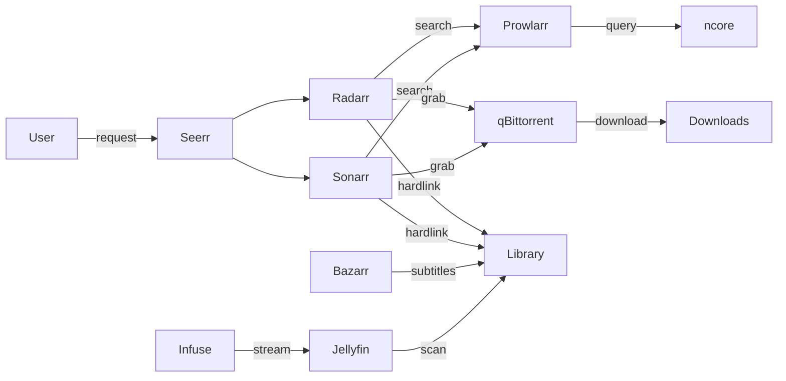

# 🎬 Media stack

Request, download, organize and stream movies and series. Content comes from ncore.pro and is watched through Jellyfin + Infuse on an Apple TV 4K.

## 🏗 Architecture



| Service     | URL                                    | Internal address   | Purpose                          |
| ----------- | -------------------------------------- | ------------------ | -------------------------------- |
| Seerr       | `https://media.${LAB_DOMAIN}`          | `seerr:5055`       | Request UI (main entry point)    |
| Radarr      | `https://radarr.media.${LAB_DOMAIN}`   | `radarr:7878`      | Movie management                 |
| Sonarr      | `https://sonarr.media.${LAB_DOMAIN}`   | `sonarr:8989`      | Series management                |
| Prowlarr    | `https://prowlarr.media.${LAB_DOMAIN}` | `prowlarr:9696`    | Indexer manager                  |
| Bazarr      | `https://bazarr.media.${LAB_DOMAIN}`   | `bazarr:6767`      | Subtitles                        |
| Jellyfin    | `https://jellyfin.media.${LAB_DOMAIN}` | `jellyfin:8096`    | Media server                     |
| qBittorrent | `https://downloads.${LAB_DOMAIN}`      | `qbittorrent:8080` | Torrent client                   |
| Recyclarr   | —                                      | —                  | TRaSH Guides config sync (no UI) |

DNS: the two wildcard records from [Manual setup §1](manual-setup.md#1-unifi-wildcard-dns-records).

## 💾 Storage layout

Every service that touches media mounts the same `${MEDIA_ROOT}` at `/media`, which is what makes hardlinks work (one copy on disk, visible in two places).

```
${MEDIA_ROOT}/
├── downloads/
│   ├── movies/          ← qBittorrent downloads here
│   └── series/          ← qBittorrent downloads here
├── movies/              ← Radarr hardlinks completed movies here
├── series/              ← Sonarr hardlinks completed series here
└── other/               ← manual (non-indexed) downloads
```

## 🚀 First-launch setup

After `dfs services start`, configure each service once, **in this order** — later ones depend on earlier ones.

### 1. qBittorrent

Get the generated password, then log in as `admin` at `https://downloads.${LAB_DOMAIN}`:

```sh
docker logs qbittorrent 2>&1 | grep "temporary password"
```

| Setting                                              | Value                                              |
| ---------------------------------------------------- | -------------------------------------------------- |
| Web UI → Authentication                              | New admin password → Bitwarden `QBITTORRENT_PASSWORD` |
| Downloads → Default Torrent Management Mode          | **Automatic** (required for category save paths)   |
| Downloads → Default Save Path                        | `/media/downloads`                                 |
| Downloads → Keep incomplete torrents in              | disabled                                           |
| BitTorrent → Seeding Limits                          | unchecked (seed indefinitely)                      |

Create categories (left sidebar → right-click → New Category):

| Category | Save path                 |
| -------- | ------------------------- |
| `movies` | `/media/downloads/movies` |
| `series` | `/media/downloads/series` |
| `manual` | `/media/other`            |

### 2. Radarr and Sonarr

Same steps in both, at `https://radarr.media.${LAB_DOMAIN}` and `https://sonarr.media.${LAB_DOMAIN}`:

|                                     | Radarr           | Sonarr           |
| ----------------------------------- | ---------------- | ---------------- |
| Bitwarden field for the API key     | `RADARR_API_KEY` | `SONARR_API_KEY` |
| Root folder                         | `/media/movies`  | `/media/series`  |
| qBittorrent category                | `movies`         | `series`         |

1. Create an admin account.
2. **Settings → General → API Key:** copy it to the Bitwarden field.
3. **Settings → Media Management → Root Folders:** add the root folder.
4. **Settings → Download Clients → Add → qBittorrent:** host `qbittorrent`, port `8080`, username `admin`, the password from step 1, the category above. Test.
5. **Settings → Connect → Add → Jellyfin** (do this after [step 7](#7-jellyfin), which creates the key): host `jellyfin`, port `8096`, the Jellyfin API key. Test and save. Jellyfin is then notified on every import, so no library scan is needed.

### 3. Language custom formats

Recyclarr only manages TRaSH custom formats, so create these by hand **before the first sync**. In both Radarr and Sonarr, **Settings → Custom Formats → Add**, with **Condition: Language**:

| Name        | Language  |
| ----------- | --------- |
| `Hungarian` | Hungarian |
| `English`   | English   |
| `Original`  | Original  |

### 4. Recyclarr

With the API keys in Bitwarden and the custom formats created:

```sh
dfs services restart recyclarr      # re-render the config with the API keys
cd profiles/homelab/mac/ops/services/media/recyclarr
docker compose run --rm recyclarr sync
```

Check **Settings → Profiles** in Radarr and Sonarr for the four profiles: `4K HU`, `4K Any`, `HD HU`, `HD Any`.

### 5. Profile language and scores

For each of the four profiles in **both** Radarr and Sonarr (**Settings → Profiles** → profile):

1. **Language: Any.** Recyclarr can't set this. ncore tags dual-audio hun/eng releases as Hungarian; "Any" keeps them from being rejected.
2. **Custom Formats:** set the scores.

| Profile  | `Hungarian` | `English` | `Original` |
| -------- | ----------- | --------- | ---------- |
| `4K HU`  | 2000        | 0         | 0          |
| `4K Any` | 0           | 2000      | 2000       |
| `HD HU`  | 2000        | 0         | 0          |
| `HD Any` | 0           | 2000      | 2000       |

### 6. Prowlarr

At `https://prowlarr.media.${LAB_DOMAIN}`:

1. Create an admin account.
2. **Settings → Indexers → Add Indexer → "ncore":** ncore username, password and passkey (ncore.pro profile, RSS/passkey section). Test.
3. **Settings → Apps → Add Application**, once per app, with Prowlarr Server `http://prowlarr:9696`:

   | App    | Server               | API key        |
   | ------ | -------------------- | -------------- |
   | Radarr | `http://radarr:7878` | Radarr API key |
   | Sonarr | `http://sonarr:8989` | Sonarr API key |

### 7. Jellyfin

At `https://jellyfin.media.${LAB_DOMAIN}`:

1. **Wizard:** create the admin user; display language English; skip adding libraries; allow remote connections.
2. **Dashboard → Libraries → Add Media Library**, three times, each with preferred language English and country Hungary:

   | Display name | Content type | Folder          |
   | ------------ | ------------ | --------------- |
   | Movies       | Movies       | `/media/movies` |
   | Series       | Shows        | `/media/series` |
   | Other        | Movies       | `/media/other`  |

3. **Dashboard → API Keys → Create:** a key for Radarr/Sonarr (step 2.5).
4. **Dashboard → Scheduled Tasks → Scan All Libraries:** run once.

### 8. Bazarr

At `https://bazarr.media.${LAB_DOMAIN}`:

1. Create an admin account.
2. **Settings → Sonarr:** address `sonarr`, port `8989`, Sonarr API key. Test and save.
3. **Settings → Radarr:** address `radarr`, port `7878`, Radarr API key. Test and save.
4. **Settings → Languages:**
   - Languages Filter: **English**, **Hungarian**
   - Add a Languages Profile (e.g. "Default") with **English** and **Hungarian**
   - Default profile for new **Series** and new **Movies**: that profile
5. **Settings → Providers:** add **OpenSubtitles.com** (free account + API key) and **subdl** (good for Hungarian).

### 9. Seerr

At `https://media.${LAB_DOMAIN}`:

1. **Wizard:** sign in with Jellyfin, URL `http://jellyfin:8096`, Jellyfin admin credentials.
2. **Settings → Jellyfin:** enable the Movies and Series libraries.
3. **Settings → Radarr** and **Settings → Sonarr**, both as default server:

   |                 | Radarr          | Sonarr          |
   | --------------- | --------------- | --------------- |
   | Hostname        | `radarr`        | `sonarr`        |
   | Port            | `7878`          | `8989`          |
   | API key         | Radarr API key  | Sonarr API key  |
   | Quality profile | **4K Any**      | **4K Any**      |
   | Root folder     | `/media/movies` | `/media/series` |

   `4K Any` is the default for non-Hungarian content; override per request.

Afterwards, continue with the [exporters](monitoring.md#-exporters), which need the API keys created here.

## 🎚 Quality profiles

Four profiles per service, strict on quality and soft on language:

| Profile  | Quality (top → bottom)                                                                 | Language preference           |
| -------- | -------------------------------------------------------------------------------------- | ----------------------------- |
| `4K HU`  | Remux-2160p, Bluray-2160p, WEB-2160p (+ HDTV-2160p in Sonarr)                          | Hungarian +2000               |
| `4K Any` | same                                                                                   | English +2000, Original +2000 |
| `HD HU`  | Remux-1080p → Bluray-1080p → WEB-1080p → HDTV-1080p → Bluray-720p → WEB-720p → HDTV-720p | Hungarian +2000             |
| `HD Any` | same                                                                                   | English +2000, Original +2000 |

- **Strict quality:** there is no fallback inside a profile (otherwise a 1080p Atmos release can outscore a plain 4K one). If a 4K profile finds nothing, re-assign the item to the matching HD profile.
- **Soft language:** scores are positive only, nothing is rejected. An `Any` profile will grab a Hungarian-only release if no English one exists; re-search manually when that happens.

| Content                              | Profile  |
| ------------------------------------ | -------- |
| Hungarian, recent                    | `4K HU`  |
| Hungarian, older (4K unlikely)       | `HD HU`  |
| Non-Hungarian, recent                | `4K Any` |
| Non-Hungarian, older                 | `HD Any` |
| 4K search came up empty              | matching `HD *` |

**What's managed where:**

| Thing                                               | Managed by                                    |
| --------------------------------------------------- | --------------------------------------------- |
| Quality tiers, TRaSH custom formats (HDR/DV, audio) | `recyclarr.yml.tmpl`, synced by Recyclarr     |
| Language custom formats                             | Manual, Radarr/Sonarr UI ([step 3](#3-language-custom-formats)) |
| Profile language + language scores                  | Manual, per profile ([step 5](#5-profile-language-and-scores)) |

**Syncing:** Recyclarr syncs daily via cron. After editing `recyclarr.yml.tmpl`, or to force a sync:

```sh
dfs services restart recyclarr      # only needed after editing the template
cd profiles/homelab/mac/ops/services/media/recyclarr
docker compose run --rm recyclarr sync
```

Syntax: [Recyclarr config reference](https://recyclarr.dev/wiki/yaml/config-reference/).

## 📺 Apple TV (Infuse)

Jellyfin publishes port 8096 directly, in addition to HTTPS through Caddy, so Infuse can connect over HTTP. The Apple TV 4K has no USB-C port, which makes installing the Caddy CA impractical.

1. Infuse → Add Share → **Jellyfin**
2. Server: `http://jellyfin.media.${LAB_DOMAIN}:8096`
3. Sign in with your Jellyfin credentials

## 📥 Manual downloads

For a magnet or `.torrent` you already have, bypassing Prowlarr/Radarr/Sonarr/Seerr entirely: no metadata match, no quality profile, no request record. qBittorrent downloads straight into `${MEDIA_ROOT}/other`, which Jellyfin serves as the read-only **Other** library. The seeding file *is* the library file.

1. Open `https://downloads.${LAB_DOMAIN}`.
2. *Add Torrent Link* (magnet) or *Add Torrent File*, with **Category: `manual`**.
3. When it finishes, trigger a scan to watch right away: **Jellyfin → Dashboard → Scheduled Tasks → Scan All Libraries**.

**Scan timing:** Jellyfin's real-time monitoring can miss changes on a macOS/OrbStack bind mount, so only the scheduled scan is dependable. To surface downloads sooner without a button press, shorten **Dashboard → Scheduled Tasks → Scan Media Library → trigger** to every few hours.

**Removing:** delete the torrent in qBittorrent. With "also delete the files" it leaves the Other library too — there is no hardlinked copy, unlike the arr-managed folders.

## 🩺 Maintenance

### Disk space

qBittorrent seeds indefinitely. Completed torrents stay in `downloads/` while their hardlinks sit in `movies/` and `series/`; both share the same disk blocks. To free space, remove old torrents in qBittorrent — the library copy remains as a regular file.

### Moving to an external HDD

1. **Pre-grant OrbStack access:** System Settings → Privacy & Security → Files and Folders → OrbStack → **Removable Volumes** on.
2. Stop everything that touches `${MEDIA_ROOT}`: qBittorrent, Radarr, Sonarr, Prowlarr, Bazarr, Jellyfin, Recyclarr, Seerr.
3. Copy, preserving hardlinks (`-H`):

   ```sh
   rsync -avH /Users/ops/HomeLab/media/ /Volumes/<NewDrive>/media/
   ```

4. Verify file counts, sizes and a sample hardlink chain on the destination.
5. Set `MEDIA_ROOT` in Bitwarden to the new path, then `dfs services init && dfs services restart`.
6. Smoke-test: qBittorrent shows no "Missing files"; Radarr/Sonarr free space reflects the new drive; Jellyfin scans and plays a sample.
7. After a few days, `rm -rf` the old `${MEDIA_ROOT}`.

> ⚠️ Skipping step 1 hangs everything. The first bind-mount under `/Volumes/` raises a macOS permission prompt; over SSH nobody sees it, so `docker ps`, `orb status` and `dfs services start` hang silently. Fix: open the OrbStack GUI on the Mini (Screen Sharing) and click Allow.

The full procedure, with macOS gotchas (volume rename collision, ownership, Spotlight indexing, energy settings) and rollback, is in `docs/superpowers/specs/2026-05-09-external-hdd-migration-design.md` (local planning docs, gitignored).
