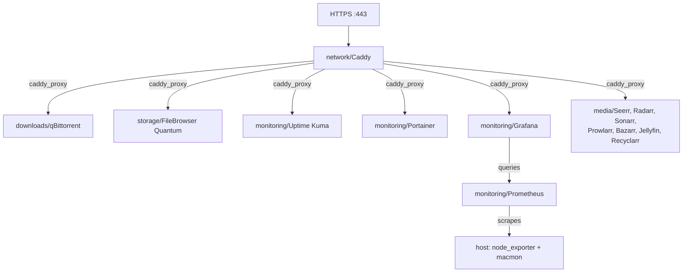

# 🐳 Homelab services

Docker services defined under `profiles/homelab/mac/ops/services/`. Everything is templated: secrets and network-specific values come from Bitwarden via `.config.json`. Rendered files, persistent data and runtime state live outside the repo.

First-time installation order is in [Setup, phase 3](setup.md#-phase-3-services).

## 🏗 Architecture



- **DNS** is resolved by the router; there is no local DNS service.
- **Caddy** terminates TLS with its own internal CA and reverse-proxies to services on the `caddy_proxy` network. It is the only service publishing host ports (80, 443).
- **App services** publish no ports and are reachable only through Caddy. The one exception is Jellyfin's 8096, for [Apple TV](media.md#-apple-tv-infuse).

## 🗺 Service map

| Category   | Service             | URL                                    | Details                       |
| ---------- | ------------------- | -------------------------------------- | ----------------------------- |
| network    | Caddy               | —                                      | this page                     |
| storage    | FileBrowser Quantum | `https://files.${LAB_DOMAIN}`          | [Manual setup §9](manual-setup.md#9-filebrowser-quantum) |
| downloads  | qBittorrent         | `https://downloads.${LAB_DOMAIN}`      | [Media](media.md)             |
| media      | Seerr, Radarr, Sonarr, Prowlarr, Bazarr, Jellyfin, Recyclarr | `https://[<name>.]media.${LAB_DOMAIN}` | [Media](media.md) |
| monitoring | Uptime Kuma         | `https://uptime.${LAB_DOMAIN}`         | [Monitoring](monitoring.md)   |
| monitoring | Grafana             | `https://monitoring.${LAB_DOMAIN}`     | [Monitoring](monitoring.md)   |
| monitoring | Portainer           | `https://containers.${LAB_DOMAIN}`     | [Manual setup §4](manual-setup.md#4-portainer) |
| monitoring | Prometheus, exporters | internal                             | [Monitoring](monitoring.md)   |

## ✅ Prerequisites

- **OrbStack** (provides Docker), launched once through the GUI. See [OrbStack gotchas](#orbstack-on-headless-macos).
- `.config.json` populated with `bw://` references (done by `make ops-init`).
- Bitwarden fields filled in — [list](setup.md#bitwarden-item) — and the vault unlocked.

## 🧰 Commands

```sh
dfs services list                # all services and status
dfs services init [name]         # first-time init
dfs services start [name]        # start (all: ordered)
dfs services stop [name]         # stop (all: reverse order)
dfs services restart <name>
dfs services status [name]
```

**Order:** when starting everything, Caddy goes first, then the rest alphabetically. Stop runs in reverse. Single-service commands have no ordering.

## 🔄 What `start` does

`dfs services start <name>`:

1. Resolves env vars from `.config.json` + Bitwarden
2. Ensures the shared `caddy_proxy` Docker network exists
3. Creates the data directory `${SERVICES_DATA_DIR}/<name>/`
4. Renders every `*.tmpl` in the service directory (`envsubst`)
5. Copies service-specific config into the data directory, if needed
6. Renders `caddy.snippet.tmpl`, if present, into `caddy/routes/<name>.snippet`
7. Reloads Caddy, if running
8. `docker compose up -d`
9. Runs `post-start.sh`, if present

`stop` runs `docker compose down`, removes the Caddy route and reloads Caddy.

## 💾 Data persistence

| In the repo (source of truth)                       | Not in the repo                              |
| --------------------------------------------------- | -------------------------------------------- |
| Templates, compose files, Caddy snippets, scripts   | Rendered configs, persistent data, secrets   |

Each service keeps its data in `${SERVICES_DATA_DIR}/<service>/`, which survives container rebuilds, restarts and OrbStack reinstalls. **Back this directory up.**

**Local routes for private projects:** Caddy also imports `${SERVICES_DATA_DIR}/caddy/routes.local/*.snippet`. Private repos that deploy their own stacks (e.g. a Portainer git stack) put their hostname → container route there by hand, so this public repo never learns their names. It is data, not config — it is covered by the `${SERVICES_DATA_DIR}` backup. Reload after adding a snippet:

```sh
docker exec caddy caddy reload --config /etc/caddy/Caddyfile
```

## ➕ Adding a service

1. Create `services/<category>/<product>/` (e.g. `monitoring/grafana/`)
2. Add `docker-compose.yml.tmpl` — this is what makes it a service
3. If web-facing, add `caddy.snippet.tmpl`
4. Add any new variables to `ops/.config.example.json` and to Bitwarden
5. `dfs services start <name>`

**`monitoring/my_service/docker-compose.yml.tmpl`**

```yaml
services:
  my_service:
    image: some/image:1.2.3
    restart: unless-stopped
    networks:
      - caddy_proxy
      - default
    volumes:
      - ${SERVICES_DATA_DIR}/my_service:/data

networks:
  caddy_proxy:
    external: true
```

**`monitoring/my_service/caddy.snippet.tmpl`**

```
my-service.${LAB_DOMAIN} {
	tls internal
	reverse_proxy my_service:8080
}
```

Always set `restart: unless-stopped`; [power-loss recovery](manual-setup.md#10-auto-recovery-after-power-loss) depends on it.

## ⚠️ Gotchas

### `caddy_proxy` is created by `services.sh`

Compose files reference `caddy_proxy` as `external: true`. `services.sh` creates it with `docker network create` before starting anything, so every service, Caddy included, treats it as pre-existing.

### OrbStack on headless macOS

- It must be launched once through the GUI (Screen Sharing) to finish its initial setup.
- It is a per-user GUI app, not a system daemon: it starts only after `ops` logs in.
- The Docker CLI lives at `~/.orbstack/bin/docker`. Interactive shells have it on PATH; non-interactive SSH (`ssh host 'docker …'`) must use the full path.
- Disconnecting VNC locks the session. Disable screen lock in System Settings → Lock Screen.
- VNC "High performance" mode often fails on first connect to a headless Mac. Connect with Adaptive, then switch via the **View** menu.

## 🔮 Future work

Intentionally not implemented:

- **Weekly Telegram digest** — a launchd script posting 7-day CPU/memory/disk averages from Prometheus.
- **Per-service exporter for Uptime Kuma.**

Both are specced in `docs/superpowers/specs/2026-04-13-grafana-prometheus-monitoring-design.md` (local planning docs, gitignored).
